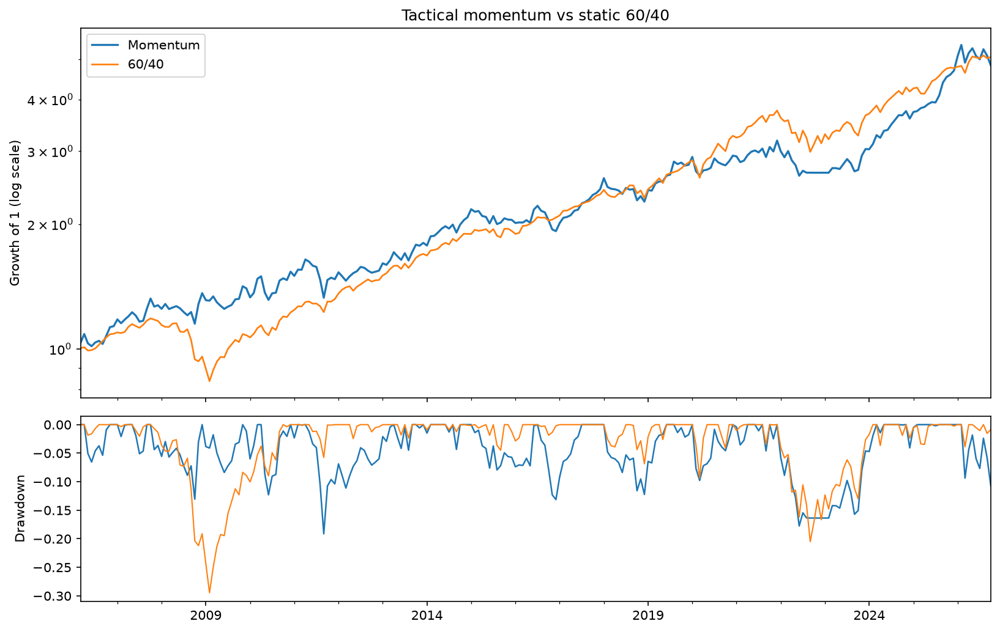
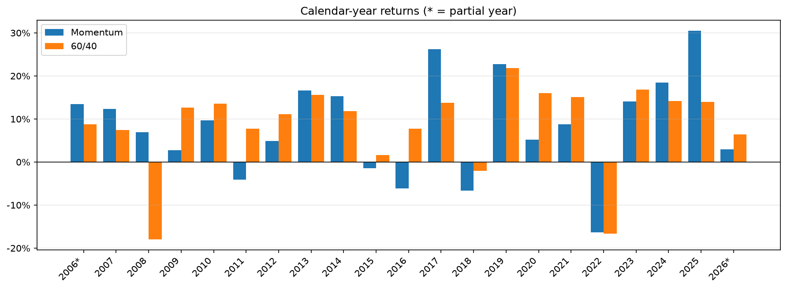
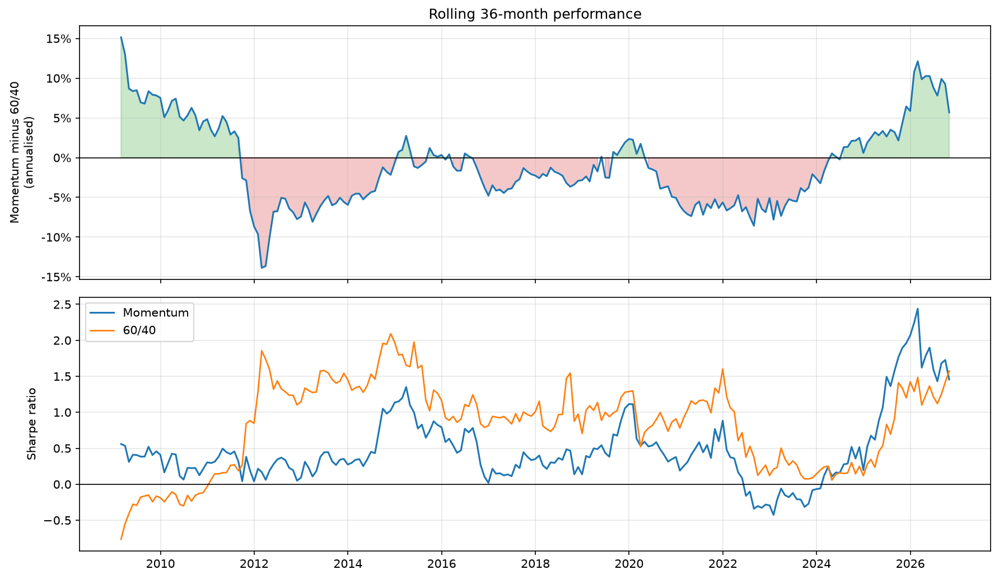
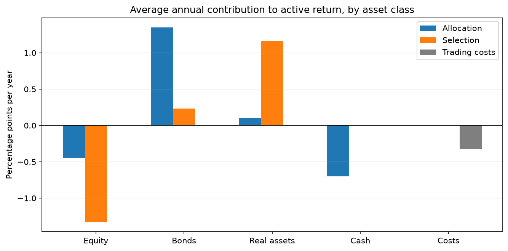
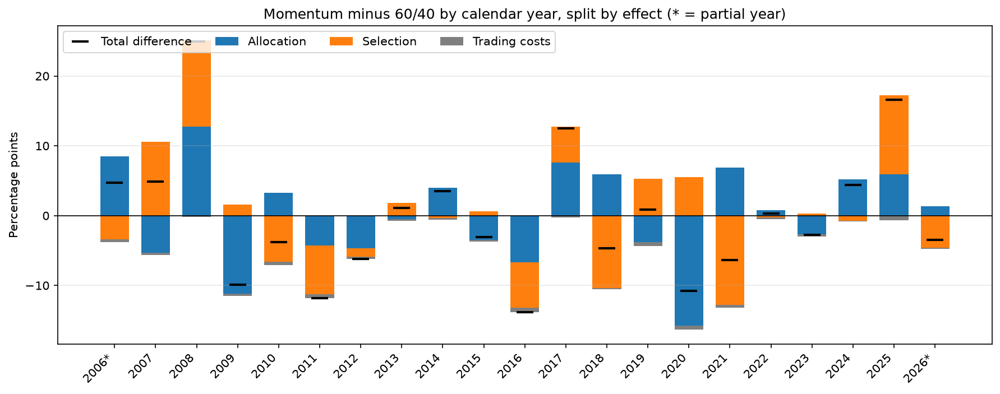

# Tactical Asset Allocation: Backtest and Performance Analysis

**Does a 12-month momentum rule beat a static 60/40 portfolio after costs, and if so, where does the difference come from?**

This project backtests a dual-momentum tactical asset-allocation strategy across seven ETFs from March 2006 to October 2026 and evaluates it against a static 60/40 portfolio in three steps:

1. **Backtest:** simulate the strategy over 20 years and compare its return, volatility, Sharpe ratio and drawdowns with the 60/40.
2. **Performance analysis:** risk-adjusted and relative metrics, calendar-year returns and rolling 3-year performance.
3. **Attribution:** Brinson-Fachler analysis by asset class, splitting the active return into allocation, selection and trading-cost effects.

> Personal research project. Not investment advice.

---

## Key findings

- **Backtest: similar return, smaller losses.** Over 20 years, momentum returned 7.9% a year against 8.2% for the 60/40, with higher volatility (12.0% vs 9.3%) but a much smaller maximum loss (−19.1% vs −29.5%).
- **Performance analysis: active risk without reward, and lumpy.** It deviated from the 60/40 by almost 10% a year (tracking error) for an information ratio of almost zero. Most of the gain came in three years (2008, 2017, 2025), and it trailed in most rolling 3-year windows from 2012 to 2023.
- **Attribution: rotation worked, implementation used up the gain.** Holding fewer bonds and more real assets added value; the equity ETFs it picked and time in cash cost value, and trading costs (−0.32 points a year) cancelled out the allocation gain (+0.32).

---

## 1. Strategy and benchmark

| | |
|---|---|
| **Universe** | SPY (US equity), EFA (developed ex-US equity), EEM (emerging equity), IEF (7–10y Treasuries), TLT (20y+ Treasuries), GLD (gold), VNQ (US REITs) |
| **Signal** | 12-month total return, skipping the most recent month (short-term reversal) |
| **Portfolio** | Top 3 assets, equally weighted; an asset with negative momentum is replaced by cash (absolute momentum) |
| **Rebalancing** | Monthly, at month-end close |
| **Costs** | 10 bps one-way, charged on turnover |
| **Benchmark** | 60% SPY / 40% IEF, rebalanced monthly |

## 2. Data

- Monthly adjusted close prices from Yahoo Finance via `yfinance` (dividends reinvested).
- All data is public, so anyone can rerun the analysis with one command.

## 3. Methodology

**No look-ahead.** Signals use data up to month-end *t* and are applied to returns in month *t+1*.

**Performance metrics.** CAGR, annualised volatility, Sharpe and Sortino ratios, maximum drawdown, Calmar ratio, tracking error, information ratio, and rolling 36-month versions of the key ratios.

**Attribution: Brinson-Fachler by asset class.** Each month, the active return (portfolio minus benchmark) is split into:

| Effect | Formula | Question it answers |
|---|---|---|
| Allocation | (w<sub>p</sub> − w<sub>b</sub>) × (r<sub>b,i</sub> − R<sub>b</sub>) | Did over- or underweighting an asset class help? |
| Selection | w<sub>p</sub> × (r<sub>p,i</sub> − r<sub>b,i</sub>) | Did choosing different ETFs within a class help (e.g. TLT instead of IEF)? |
| Trading costs | − turnover × cost | How much implementation cost |

*w* = weight of asset class *i*, *r* = return of asset class *i*, *R<sub>b</sub>* = total 60/40 return; *p* = momentum portfolio, *b* = 60/40 benchmark. Selection includes the interaction term, a common presentation that keeps two effects instead of three.

| Asset class | ETFs momentum can hold | 60/40 weight | Benchmark return used for the class |
|---|---|---|---|
| Equity | SPY, EFA, EEM | 60% | SPY |
| Bonds | IEF, TLT | 40% | IEF |
| Real assets | GLD, VNQ | 0% | 50/50 GLD + VNQ (neutral mix, since the 60/40 holds none) |
| Cash | Uninvested weight | 0% | 0% (cash earns no interest) |

The monthly effects add up exactly to the monthly active return; the code checks this reconciliation on every run. Results are shown as average annual contributions (average monthly effect × 12) and by calendar year, where monthly effects are linked with the **Carino method** so that each year's effects add up exactly to that year's return difference.

## 4. Results

### Backtest

*Source: `notebooks/01_backtest.ipynb`*

| | Momentum (net of costs) | 60/40 benchmark |
|---|---|---|
| CAGR | 7.92% | 8.16% |
| Volatility | 11.99% | 9.25% |
| Sharpe ratio | 0.49 | 0.67 |
| Max drawdown | −19.13% | −29.46% |
| Calmar ratio | 0.41 | 0.28 |
| Positive months | 57.26% | 66.94% |
| Avg monthly turnover | 27.02% | — |
| Months fully in cash | 2.81% | — |

*Period: March 2006 to October 2026 (248 months), monthly data.*


*Top: growth of $1 invested in March 2006 (log scale). Bottom: decline from the previous peak.*

### Performance analysis

*Source: `notebooks/02_performance_analysis.ipynb`*

| | Momentum | 60/40 |
|---|---|---|
| Sortino ratio | 0.79 | 1.00 |
| Best month | 11.56% | 7.73% |
| Worst month | −9.68% | −10.26% |

| Momentum relative to 60/40 | |
|---|---|
| Active return (annualised) | 0.06% |
| Tracking error | 9.87% |
| Information ratio | 0.01 |
| Beta | 0.77 |
| Correlation | 0.59 |
| Months beating 60/40 | 48.8% |
| Full calendar years beating 60/40 | 9 of 19 |
| Rolling 36-month windows beating 60/40 | 38% |

- **Active risk without reward.** The strategy deviated from the 60/40 by almost 10% a year (tracking error), but its average active return was close to zero, so the information ratio is essentially zero.
- **Gains concentrated in a few years.** Large wins in 2008 (+25 percentage points), 2025 (+17) and 2017 (+12.5) offset losses in 2016 (−14), 2011 (−12), 2020 (−11) and 2009 (−10). It led in only 9 of 19 full years and trailed in most rolling 3-year windows between 2012 and 2023. In 2022 both portfolios lost about 16%.
- **A different return pattern.** A correlation of 0.59 and a beta of 0.77 show it behaves quite differently from the 60/40. Part of its higher volatility is upside: its best month was +11.6% against +7.7%, while the worst months were similar.


*Calendar-year returns. 2006 and 2026 are partial years.*


*Top: momentum minus 60/40, annualised over the previous 36 months. Bottom: rolling 36-month Sharpe ratios.*

### Attribution

*Source: `notebooks/03_attribution.ipynb`*

**Average weights**

| Asset class | Momentum | 60/40 | Difference |
|---|---|---|---|
| Equity | 44.6% | 60.0% | −15.4% |
| Bonds | 16.1% | 40.0% | −23.9% |
| Real assets | 33.7% | 0.0% | +33.7% |
| Cash | 5.5% | 0.0% | +5.5% |

**Average annual contribution to active return** (percentage points per year)

| Asset class | Allocation | Selection | Total |
|---|---|---|---|
| Equity | −0.44 | −1.33 | −1.77 |
| Bonds | +1.35 | +0.23 | +1.58 |
| Real assets | +0.11 | +1.16 | +1.27 |
| Cash | −0.70 | — | −0.70 |
| Trading costs | | | −0.32 |
| **Total** | **+0.32** | **+0.06** | **+0.06** |

The total of +0.06 points a year equals the annualised active return. It is slightly positive although momentum's CAGR is lower, because the more volatile strategy loses more to compounding (volatility drag).

- **Allocation helped, but costs used it up.** Asset allocation added +0.32 points a year, mainly by holding far fewer bonds than the 60/40 (16% against 40% on average). Trading costs took −0.32 points a year, so the net result was close to zero.
- **Bonds and real assets added value, equities and cash cost it.** Underweighting bonds (+1.58) and choosing between gold and REITs (+1.27) helped. The equity ETFs it picked lagged the S&P 500 when it held international or emerging-market equities (selection −1.33), and time in cash cost −0.70 a year, as the strategy tended to hold cash in months when the 60/40 did well. Cash earns no interest in this backtest, so the cash effect is slightly overstated.
- **The 2008 protection came from rotation, not cash.** In 2008 (+25.0 points against the 60/40), the gains came from equities (+9.6), bonds (+9.3) and real assets (+6.9), while cash contributed −0.8. The strategy had moved into the asset classes that held up, rather than out of the market.
- **Large losses came from turning points.** In 2020 (−10.8), allocation alone cost −15.7 points in a year of a sharp crash followed by a rapid recovery, the kind of reversal a 12-month signal is slow to follow. In 2016 (−13.8) and 2011 (−11.8), equities and real assets both detracted.


*Average annual contribution to active return by asset class and effect.*


*Momentum minus 60/40 by calendar year, split into allocation, selection and trading costs. The black marks show each year's total difference. 2006 and 2026 are partial years.*

## 5. Limitations

- **Short, survivorship-biased history.** ETFs only go back to the early 2000s, and the universe contains funds that still exist today.
- **Idealised execution.** Fills at month-end close, flat 10 bps cost, no taxes.
- **One strategy family.** Momentum is well documented in the literature, so the edge, if any, may already be arbitraged away.
- **Attribution is by asset class**, not by security, and depends on the chosen class benchmarks (notably the GLD/VNQ proxy).

## 6. Project structure

```
├── notebooks/
│   ├── 01_backtest.ipynb               # backtest: return and risk statistics, growth and drawdown chart
│   ├── 02_performance_analysis.ipynb   # extended metrics, calendar-year returns, rolling 36-month view
│   └── 03_attribution.ipynb            # Brinson-Fachler attribution by asset class
├── src/
│   ├── backtest.py                     # strategy, benchmark, costs and statistics (shared by all notebooks)
│   └── attribution.py                  # Brinson-Fachler effects and Carino linking
├── reports/figures/                    # charts used in this README (saved by the notebooks)
├── requirements.txt
└── README.md
```

## 7. How to run

From the project folder:

```bash
pip install -r requirements.txt
jupyter lab
```

Then open the notebooks in `notebooks/` and run them in order (01 → 03). Each notebook downloads the price data, runs the backtest through `src/backtest.py` and saves its charts to `reports/figures/`.
